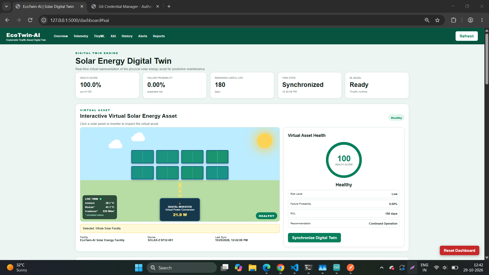
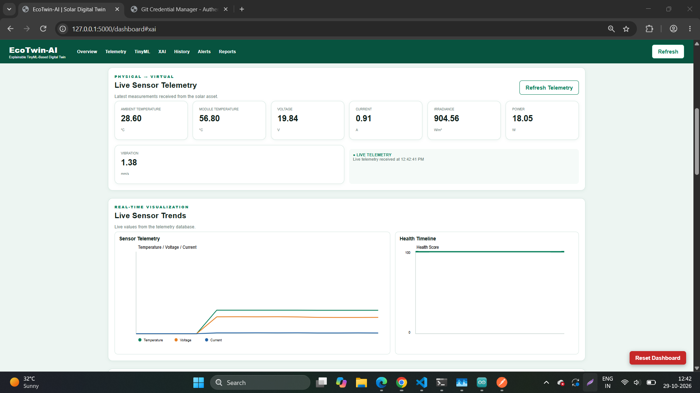
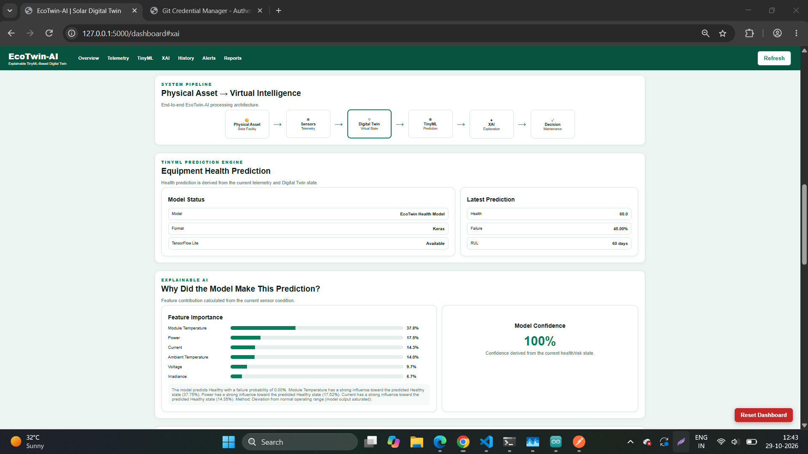
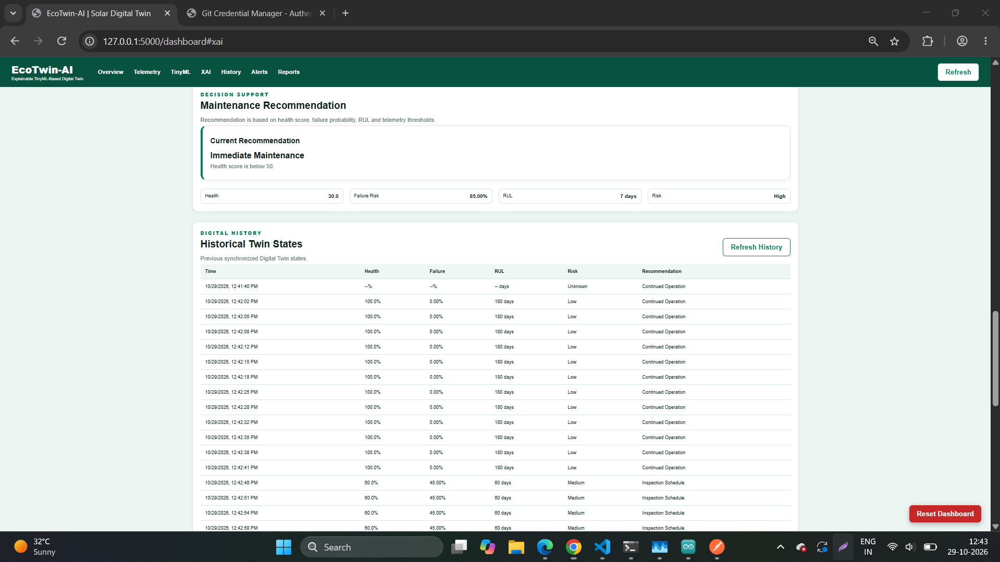
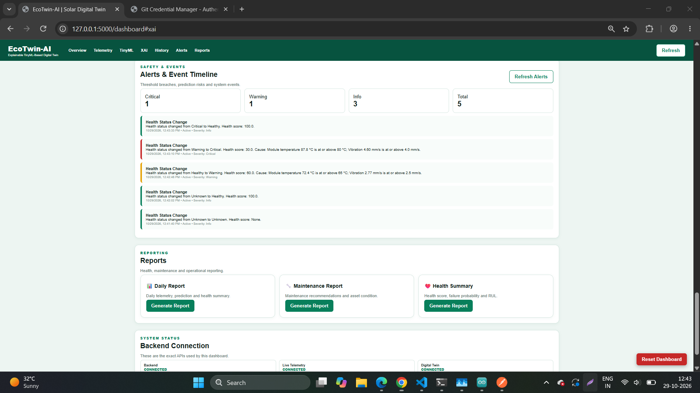
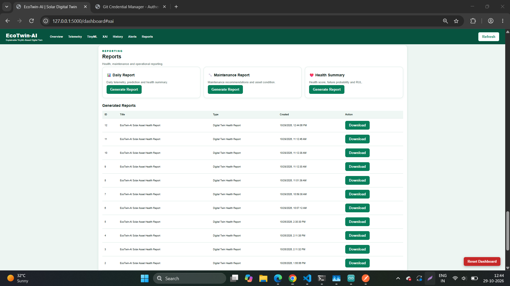
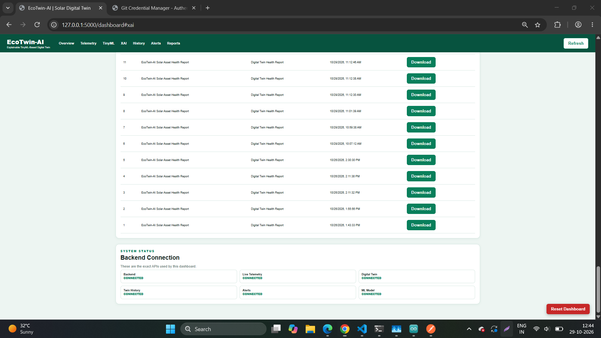

# EcoTwin-AI


**Explainable TinyML-based digital twin for solar energy predictive maintenance**, with ESP32 + DHT22 sensing, a Flask backend, a rule-based safety layer, explainable AI and physical LED feedback.

## Overview

EcoTwin-AI keeps a virtual model of a solar energy asset synchronized with incoming telemetry. It scores the asset's health, estimates risk and remaining useful life, explains the result, recommends maintenance, and shows the status on both a web dashboard and three LEDs on an ESP32.


## Real vs simulated data

This is a prototype. Please read this before judging the results.

| Parameter | Source |
|---|---|
| Ambient temperature | **Real**, measured by a DHT22 on the ESP32 |
| Humidity | **Real**, measured by the DHT22 (shown on the ESP32 serial output, not stored in the telemetry database) |
| Module temperature, voltage, current, power, irradiance, vibration | **Simulated** by `demo_simulation.py` |
| Health status shown by the LEDs | Computed by the digital twin (model + rule layer) |

No solar panel or current sensor is connected. Do not treat the simulated values as measurements.

## Features

- Digital twin state synchronized from telemetry, with history
- TinyML health model (INT8 TensorFlow Lite) with failure probability and an RUL indicator
- Rule-based safety layer on top of the model (see below)
- Explainable AI: feature importance, with a deviation-based fallback
- Alerts and event timeline, created when the health status changes
- Maintenance recommendations
- Reports (daily, maintenance, health summary)
- What-if simulation endpoint
- Animated dashboard with a reset button
- ESP32 firmware with green, yellow and red status LEDs

## Architecture

```
DHT22 + ESP32 --Wi-Fi/HTTP--> Flask backend --> Digital Twin --> TinyML + rule layer --> XAI
       ^                          ^                    |
       |                          |                    v
   LED feedback <------- twin health status      Dashboard
                                  ^
                 demo_simulation.py (simulated solar values)
```

## Hardware

| Part | Notes |
|---|---|
| ESP32 development board (NodeMCU-style) | Board setting: ESP32 Dev Module |
| DHT22 sensor | DATA to GPIO 4, VCC to 3.3 V, GND to GND |
| 3 LEDs + 3 resistors (220 ohm) | Green GPIO 25, Yellow GPIO 26, Red GPIO 27, cathodes to GND |

## Software requirements

- Python 3.10 or newer (a version compatible with your TensorFlow install)
- Arduino IDE 2.x with the ESP32 board package
- Arduino libraries: DHT sensor library, Adafruit Unified Sensor, ArduinoJson

## Quick start

### 1. Backend

```powershell
git clone https://github.com/CHANGE-YOURNAME/EcoTwin-AI.git
cd EcoTwin-AI
python -m venv venv
.\venv\Scripts\activate
pip install -r requirements.txt
python -m backend.app
```

Start the app with `python -m backend.app`, not `python backend\app.py`.

Open the dashboard at `http://127.0.0.1:5000/dashboard`.

### 2. Demo simulator

In a second terminal:

```powershell
.\venv\Scripts\activate
python demo_simulation.py
```

It cycles through five scenarios: Normal, Temperature Rise, Warning, High Risk and Recovery. Ambient temperature is taken from the ESP32 when it is online, and falls back to a demo value otherwise.

### 3. ESP32

1. Open `firmware/EcoTwin_ESP32/EcoTwin_ESP32.ino` in Arduino IDE.
2. Set `WIFI_SSID`, `WIFI_PASSWORD` and `SERVER_IP` (your computer's IPv4 address on the same network). Use a 2.4 GHz network. Do not commit real credentials.
3. Select **ESP32 Dev Module** and the correct port, then upload. If the upload stalls at "Connecting...", hold the BOOT button.
4. Open the Serial Monitor at 115200 baud.

Allow the backend through the firewall if the ESP32 cannot connect (run as administrator):

```powershell
New-NetFirewallRule -DisplayName "EcoTwin Flask" -Direction Inbound -Protocol TCP -LocalPort 5000 -Action Allow -Profile Any
```

## Health logic

The TinyML model alone rates the demo values as healthy, because they are outside its training range. A rule layer therefore overrides the model's health fields:

| Condition | Status | Score | Failure probability | RUL |
|---|---|---|---|---|
| Module temperature >= 80 C or vibration >= 4.0 mm/s | Critical | 30 | 85% | 7 days |
| Module temperature >= 65 C or vibration >= 2.5 mm/s | Warning | 60 | 45% | 60 days |
| Otherwise | Model output | | | |

These thresholds are prototype values, not validated solar safety limits.

| LED | Meaning |
|---|---|
| Green | Healthy |
| Yellow | Warning |
| Red | Critical |

## API

| Method | Endpoint | Purpose |
|---|---|---|
| GET | `/api/health` | Service health check |
| POST | `/api/telemetry/` | Store a full telemetry reading |
| GET | `/api/telemetry/latest` | Latest value per parameter |
| POST / GET | `/api/telemetry/esp32` | ESP32 temperature and humidity (in memory) |
| POST | `/api/predict` | Run the model and XAI |
| GET | `/api/predictions` | Prediction history |
| GET | `/api/predictions/<id>/explanation` | XAI explanation |
| GET | `/api/digital-twin` | Current twin state |
| POST | `/api/digital-twin/synchronize` | Refresh the twin |
| GET | `/api/digital-twin/history` | Twin history |
| POST | `/api/digital-twin/simulate` | What-if simulation |
| POST | `/api/digital-twin/reset` | Delete stored data for a facility |
| GET | `/api/alerts` | Alerts |
| GET / POST | `/api/reports` | Reports |

## Project structure

```
backend/        Flask app, routes, services, models, ML files
frontend/       Dashboard templates and static files
firmware/       ESP32 Arduino sketch
data/           Solar dataset used for training and XAI baselines
docs/images/    Screenshots
demo_simulation.py   Presentation simulator
```

## Limitations

- Only ambient temperature and humidity are measured. Everything else is simulated.
- The ML model does not reflect the demo scenarios. The rule layer does most of the fault detection.
- Vibration is not an input to the ML model. Only the rule layer uses it.
- RUL is a health-based indicator, not a physical lifetime prediction.
- The XAI uses a deviation-based fallback when the model output is saturated.
- Humidity is not stored by the telemetry database.
- The backend is a development server with no authentication. Do not expose it to the internet.

## Roadmap

- Add real PV sensors (for example INA219 for voltage and current)
- Retrain the model on correctly scaled, labeled fault data
- Store humidity in the database
- Add what-if buttons to the dashboard

## License

MIT. See [LICENSE](LICENSE).

## Screenshots








